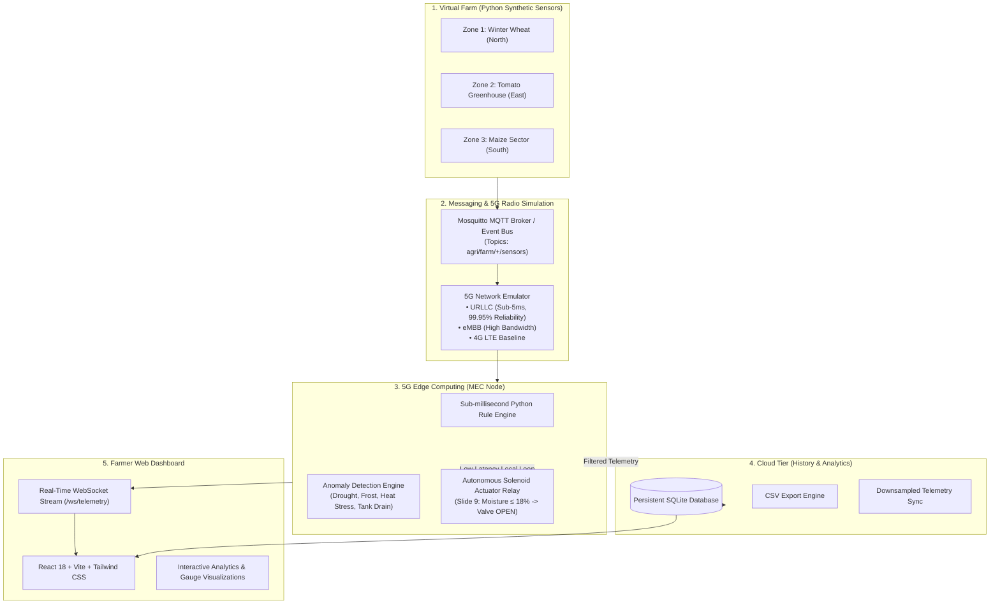

# 5G-EDGE AGRI: A Software-Based 5G-Enabled Edge Computing Framework for Real-Time Smart Agriculture

> **5G Mobile Communication • Learning Activity**  
> **TEAM 14**  
> **1NT24CS202 — PRAJWAL KARADI**  
> **1NT24CS190 — PADAVALA RISHI**  
> **Department of Computer Science and Engineering**  
> *Software-only prototype • No physical agricultural hardware required*

---

## 🌾 1. Project Overview & Motivation

Smart agricultural systems increasingly rely on Internet-of-Things (IoT) sensors to continuously generate micro-climate, soil moisture, ambient temperature, relative humidity, and water reservoir telemetry. In conventional **Cloud-only** frameworks, all sensor data travels through cellular uplinks, multiple internet routing hops, and centralized cloud data centers before decisions are generated. This causes:
1. **Critical communication delays** (often 120–250 ms or higher under congested WANs).
2. **Heavy bandwidth overhead** from streaming raw high-frequency sensor readings over WAN links.
3. **Single points of failure**: field crops wither if internet connectivity drops during drought conditions.

**5G-EdgeAgri** solves this by co-locating lightweight decision rules at the **5G Edge (Multi-Access Edge Computing / MEC)** adjacent to the 5G Base Station (gNodeB). Time-sensitive alerts and irrigation valves actuate in **< 4 milliseconds**, while aggregated historical trends sync reliably to the cloud.

---

## 🔬 2. Research Question & Gaps Addressed

### Research Question (Slide 4)
> **"Can a software-simulated 5G + Edge architecture reduce response latency and communication overhead for real-time smart-agriculture monitoring?"**

### Research Gaps Addressed
1. **Practical 5G + Edge Demonstration**: Compact, reproducible software architecture connecting 5G, IoT, Edge, and Cloud.
2. **Controlled Edge vs Cloud Evaluation (Slide 8)**: Identical synthetic workloads routed simultaneously through Edge and Cloud paths to measure response latency, computation time, and bandwidth overhead.
3. **Software-Only Accessibility**: High-fidelity virtual sensors eliminate dependence on physical breadboards, Arduinos, ESP32s, or Raspberry Pis.
4. **Real-Time vs Historical Workloads**: Critical events handled at the edge in sub-milliseconds; historical analytics retained in SQLite.

---

## 🏛️ 3. System Architecture



---

## 🚀 4. Key Capabilities & Features

### 4.1 Slide 9 Primary Farmer Scenario
- **Condition:** Soil Moisture drops to **≤ 18%** (or custom threshold).
- **Edge Action:** Local MEC engine detects critical drought condition in **< 1 ms**.
- **Actuation:** Solenoid valve triggers automatically (`IRRIGATION REQUIRED`), dispensing calibrated water dosage (150–250 L) and notifying the farmer via WebSocket toast alerts.

### 4.2 Controlled Edge vs Cloud Evaluation (Slide 8)
An integrated benchmark laboratory runs identical synthetic workloads (25 to 250 sensor events) through:
1. **Edge Path:** `Sensor → 5G URLLC → Edge Node → Local Actuator`
2. **Cloud Path:** `Sensor → 5G/4G → Internet WAN → Remote Cloud → Remote Decision → Return Trip`

**Experimental Results Measured Live:**
- **Response Latency:** Edge (~3.8 ms) vs Cloud (~154 ms) → **~97.5% latency reduction!**
- **Processing Time:** Edge (~0.9 ms) vs Cloud (~18 ms).
- **Communication Overhead:** ~75% bandwidth reduction via local event filtering.
- **Decision Consistency:** 100% logic parity between edge and cloud.

### 4.3 Virtual Sensor Physics Engine
Simulates multi-zone agricultural thermodynamics without physical hardware:
- **Soil Moisture (%):** Realistic evaporation curves, crop water absorption, irrigation replenishment.
- **Ambient Temperature (°C) & Humidity (%):** Sinusoidal diurnal solar cycle.
- **Water Reservoir Level (%):** Depletes as solenoid valves discharge water.
- **Solar Radiation (W/m²), Soil pH (6.2–6.8), and Battery Level (%).**
- **Synthetic Anomaly Injection Menu:** Test Drought Surge (≤18%), Heatwaves (>38°C), Reservoir Drains (<10%), or Frost Spikes on demand.

### 4.4 Simulation vs Real Measurements Transparency
> [!IMPORTANT]
> All sensor readings, network transmissions, and actuation events are clearly flagged with `simulated_flag: true` in the API, database schema, and dashboard UI to ensure complete academic transparency.

---

## 📁 5. Complete Folder Structure

```
5G-EDGEAGRI PROJECT/
├── backend/
│   ├── app/
│   │   ├── __init__.py
│   │   ├── main.py              # FastAPI app, CORS, lifespan, WebSocket manager
│   │   ├── config.py            # Pydantic v2 application settings
│   │   ├── database.py          # SQLite engine and session factory
│   │   ├── models.py            # SQLAlchemy models (Readings, Alerts, Actuators, Benchmarks)
│   │   ├── schemas.py           # Pydantic v2 validation models
│   │   ├── edge_engine.py       # Sub-millisecond rule engine & anomaly detector
│   │   ├── network_sim.py       # 5G URLLC / eMBB / 4G / Cloud WAN simulator
│   │   ├── mqtt_service.py      # Mosquitto MQTT client with resilient auto-fallback
│   │   ├── virtual_sensors.py   # Multi-zone synthetic sensor telemetry generator
│   │   ├── cloud_sync.py        # Cloud persistence & seed management
│   │   ├── routes/
│   │   │   ├── __init__.py
│   │   │   ├── telemetry.py     # Live telemetry, historical query, CSV export, anomaly injection
│   │   │   ├── alerts.py        # Priority alerts feed & acknowledge endpoints
│   │   │   ├── edge.py          # Dynamic edge rule threshold configuration
│   │   │   ├── actuators.py     # Solenoid valves / pumps manual override & status
│   │   │   ├── network.py       # 5G wireless profile selection & network counters
│   │   │   └── benchmark.py     # Controlled Edge vs Cloud evaluation runner
│   │   └── tests/
│   │       ├── __init__.py
│   │       ├── test_api.py          # API route integration tests
│   │       ├── test_edge_engine.py  # Slide 9 critical condition & rule tests
│   │       └── test_network_sim.py  # 5G vs 4G vs WAN latency tests
│   ├── requirements.txt
│   └── run_backend.py
├── frontend/
│   ├── src/
│   │   ├── main.jsx
│   │   ├── App.jsx                  # Main dashboard layout, tabs, WebSocket handler
│   │   ├── index.css                # Tailwind glassmorphism styles
│   │   ├── components/
│   │   │   ├── Header.jsx               # Team 14 header, simulation banner, anomaly injector
│   │   │   ├── LiveSensors.jsx          # Live telemetry cards & Slide 9 critical banner
│   │   │   ├── TelemetryCharts.jsx      # Recharts historical trends & threshold lines
│   │   │   ├── EdgeVsCloudComparison.jsx# Slide 8 controlled evaluation laboratory
│   │   │   ├── NetworkSimulator.jsx     # 5G wireless profile controller
│   │   │   ├── AlertsFeed.jsx           # Priority-filtered alerts feed
│   │   │   ├── EdgeRulesConfig.jsx      # Live edge threshold slider controls
│   │   │   ├── ActuatorControls.jsx     # Valve controls & SQLite actuation history
│   │   │   └── HistoricalDataExport.jsx # Searchable readings table & CSV export
│   │   └── services/
│   │       ├── api.js                   # REST API client
│   │       └── websocket.js             # Reconnecting WebSocket client
│   ├── package.json
│   ├── vite.config.js
│   ├── tailwind.config.js
│   ├── postcss.config.js
│   └── index.html
├── scripts/
│   ├── seed_demo_data.py        # Seeds realistic 24-hour agricultural history
│   └── standalone_sensors.py    # Independent external field sensor script
├── run.bat                      # Windows one-click launcher
├── run.ps1                      # Windows PowerShell launcher
├── pytest.ini                   # Pytest configuration
└── README.md                    # Project documentation
```

---

## ⚡ 6. Quick Start & Execution

### Option A: One-Click Windows Launch (Recommended)
Double-click `run.bat` or run in Command Prompt:
```cmd
run.bat
```
This script automatically:
1. Verifies Python 3 and Node.js.
2. Initializes the virtual environment and installs dependencies.
3. Seeds the SQLite database with 432 realistic 24-hour sensor data points.
4. Launches the FastAPI backend (`http://127.0.0.1:8000`).
5. Launches the React dashboard (`http://localhost:3000`).
6. Opens `http://localhost:3000` in your default browser.

### Option B: PowerShell Launcher
```powershell
.\run.ps1
```

### Option C: Manual Setup Step-by-Step

#### 1. Backend Setup
```bash
# Create virtual environment
python -m venv venv
.\venv\Scripts\activate

# Install dependencies
pip install -r backend/requirements.txt

# Seed realistic demo database
python scripts/seed_demo_data.py

# Start FastAPI server
python -m uvicorn backend.app.main:app --port 8000 --reload
```
- Swagger API Docs: `http://127.0.0.1:8000/docs`
- Root Info Endpoint: `http://127.0.0.1:8000/`

#### 2. Frontend Setup
```bash
cd frontend
npm install
npm run dev
```
- Dashboard UI: `http://localhost:3000`

---

## 🧪 7. Automated Testing Suite

All edge decision rules, 5G latency models, and API endpoints are covered by automated unit and integration tests.

Run tests using Pytest:
```bash
.\venv\Scripts\pytest -v
```

**Test Coverage Highlights:**
- `test_critical_soil_moisture_triggers_irrigation`: Validates Slide 9 scenario (Moisture = 18% triggers `CRITICAL_SOIL_DROUGHT` alert and activates solenoid valve in < 20 ms).
- `test_water_tank_critical_depletion`: Validates that empty water tank prevents pump dry-run burnouts.
- `test_network_profiles_latency_comparison`: Validates sub-5ms 5G URLLC performance vs legacy 4G and WAN.
- `test_controlled_benchmark_evaluation`: Verifies Edge vs Cloud benchmark evaluation calculation.

---

## 📊 8. REST & WebSocket API Reference

| Endpoint | Method | Description |
|---|---|---|
| `GET /` | GET | System status, academic metadata, simulation flag |
| `GET /api/telemetry/live` | GET | Latest real-time readings for all zones |
| `GET /api/telemetry/history` | GET | Historical time-series with zone and hour filters |
| `GET /api/telemetry/export-csv` | GET | Download complete telemetry records as CSV |
| `POST /api/telemetry/inject-anomaly` | POST | Manually inject drought, heatwave, or frost |
| `GET /api/alerts` | GET | Filterable priority alerts list |
| `PUT /api/alerts/{id}/acknowledge` | PUT | Acknowledge individual alert |
| `GET /api/edge/configs` | GET | Read active edge threshold rules |
| `PUT /api/edge/configs/{zone_id}` | PUT | Dynamically update thresholds without reboot |
| `GET /api/actuators/status` | GET | Current solenoid valve states |
| `POST /api/actuators/trigger` | POST | Manual farmer remote valve override |
| `GET /api/network/profiles` | GET | Available 5G / 4G / WAN wireless profiles |
| `POST /api/network/set-profile` | POST | Switch active radio simulation profile |
| `POST /api/benchmark/run` | POST | Run controlled Edge vs Cloud workload test (Slide 8) |
| `WS /ws/telemetry` | WS | Real-time bi-directional telemetry & alert stream |

---

## 📚 9. Literature Review References (Slide 10)

1. **Sensors (2025):**  
   *Edge Computing-Enabled Smart Agriculture: Technical Architectures, Practical Evolution, and Bottleneck Breakthroughs.*  
   DOI: [10.3390/s25175302](https://doi.org/10.3390/s25175302)
2. **Computers and Electronics in Agriculture (2022):**  
   *5G in agri-food — A review on current status, opportunities and challenges.*  
   DOI: [10.1016/j.compag.2022.107291](https://doi.org/10.1016/j.compag.2022.107291)
3. **IEEE ICECET (2023):**  
   *A Review on Edge Computing in 5G-Enabled IoT for Agricultural Applications: Opportunities and Challenges.*  
   DOI: [10.1109/ICECET58911.2023.10389349](https://doi.org/10.1109/ICECET58911.2023.10389349)
4. **Journal of Sensors (2020):**  
   *Edge Computing-Enabled Wireless Sensor Networks for Multiple Data Collection Tasks in Smart Agriculture.*  
   DOI: [10.1155/2020/4398061](https://doi.org/10.1155/2020/4398061)
5. **IEEE World Forum on Internet of Things (2023):**  
   *Edge Computing in Smart Agriculture Scenario Based on TinyML for Irrigation Control.*  
   DOI: [10.1109/WF-IoT58464.2023.10539452](https://doi.org/10.1109/WF-IoT58464.2023.10539452)
6. **Results in Engineering (2025):**  
   *Edge-enabled Smart Agriculture Framework: Integrating IoT, Lightweight Deep Learning, and Agentic AI for Context-Aware Farming.*  
   DOI: [10.1016/j.rineng.2025.107342](https://doi.org/10.1016/j.rineng.2025.107342)

---

## 👥 10. Authors & Acknowledgements

- **Prajwal Karadi** (USN: `1NT24CS202`)
- **Padavala Rishi** (USN: `1NT24CS190`)
- **Degree:** Bachelor of Engineering in Computer Science and Engineering
- **Course:** 5G Mobile Communication • Learning Activity
